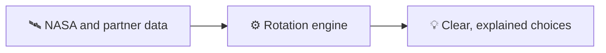

# 🛰️ FieldShift Orbit
### Turning NASA satellite data into smarter crop-rotation decisions

*Built for the **NASA International Space Apps Challenge 2026** hackathon 
· Challenge: **Field Shift***

**[▶ Open the live website](https://courageous-gaufre-840dff.netlify.app/#twin)**

---

## 🌍 The problem we set out to solve

Every farming season, someone has to answer a hard question: **what should be planted next?** Rainfall is less predictable, summers are hotter, and a crop that rebuilds the soil in one place can drain water or invite disease in another. The data to answer this exists. NASA has been watching the planet for decades. But it is scattered across many sources, in different formats and resolutions, and hard to turn into a decision.

**FieldShift Orbit brings it together.** It fuses six NASA datasets with soil and crop information and tests every sensible three-season rotation against normal, dry, wet and hot years (357 rotations × 4 scenarios = 1,428 simulations on our pilot farm, using 25 years of data). Then it does the part we care about most: it **explains its answers**. Every strategy shows why it was suggested, the evidence behind it, its benefits, and the risks and information gaps that still need local review.

## 👥 Who it helps

Agricultural extension officers and advisors, agronomists, researchers, development agencies and agri-planning teams. It gives them clear options and evidence to discuss with the communities they support, in minutes rather than weeks.

## 🛠️ How it works

## 📡 Data sources

**NASA:** [POWER](https://power.larc.nasa.gov/) · [GPM IMERG](https://gpm.nasa.gov/data/imerg) · [SMAP](https://smap.jpl.nasa.gov/) · [MODIS](https://modis.gsfc.nasa.gov/) · [Landsat 8/9](https://landsat.gsfc.nasa.gov/) · [NASADEM](https://lpdaac.usgs.gov/products/nasadem_hgtv001/)

**Partners and open data:** [ERA5 (ECMWF)](https://www.ecmwf.int/en/forecasts/dataset/ecmwf-reanalysis-v5) via [Open-Meteo](https://open-meteo.com/) · [SoilGrids (ISRIC)](https://soilgrids.org/) · [FAO-56](https://www.fao.org/4/x0490e/x0490e00.htm) · [Microsoft Planetary Computer](https://planetarycomputer.microsoft.com/)

## 📍 Pilot site

A 2 ha rain-fed farm in Soroti, Teso, Uganda (1.71°N, 33.61°E).
The engine works for any location.

## ⚠️ Limitations

- Right now the app is demonstrated on one pilot farm.
- It is currently available in English only.
- Results should be checked on the ground before they guide real decisions.

*FieldShift Orbit supports expert judgment; it doesn't replace it.*

## 🚀 Future scope

- Extend the engine to Karnataka, India, covering all 31 districts.
- Add local rain-gauge readings and lab soil tests to validate the satellite data.
- Integrate more Earth observation data, such as ECOSTRESS, GRACE and Sentinel-2.
- Add local-language support and delivery by SMS or mobile for field advisors.

---

## 📝 About this project

- Created for the **NASA Space Apps Challenge**. 
- This project is **not affiliated with or endorsed by NASA**
- **no NASA logos or branding are used**.

    
Thank you for visiting

