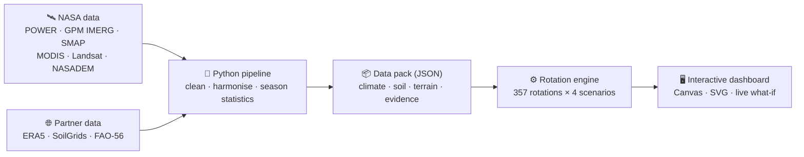

# 🛰️ FieldShift Orbit
### Turning NASA satellite data into smarter crop-rotation decisions

*Built for the **NASA International Space Apps Challenge 2026** hackathon · Challenge: **Field Shift***

**[▶ Open the live website](https://courageous-gaufre-840dff.netlify.app/#twin)**

---

## 🌍 The problem we set out to solve

Every farming season, someone has to answer a hard question: **what should be planted next?** Rainfall is less predictable, summers are hotter, and a crop that rebuilds the soil in one place can drain water or invite disease in another. The data to answer this exists. NASA has been watching the planet for decades. But it is scattered across many sources, in different formats and resolutions, and hard to turn into a decision.

**FieldShift Orbit brings it together.** It fuses six NASA datasets with soil and crop information, tests every sensible three-season rotation against normal, dry, wet and hot years, and then does the part we care about most: it **explains its answers**.

## ✨ See it in action

Under default priorities on our pilot farm, the app compared the common "maize every season" habit with the best option it found:

| | Existing: Maize → Maize → Maize | Top pick: Cowpea → Finger millet → Cowpea |
|---|---|---|
| Score (normal year) | 50 / 100 | **81 / 100** |
| Score (dry year) | 38 / 100 | **76 / 100** |
| Soil nitrogen balance over 3 seasons | −102 kg/ha | **+16 kg/ha** |
| Rank among 357 feasible rotations | #349 | **#1** |

Change the sliders and every ranking updates instantly.

## 🧩 What's inside

- 🛰️ **Digital farm twin:** location, soil estimates, terrain (slope and drainage) and a calendar showing when fields tend to be bare.
- 📈 **Climate observatory:** 25 years of NASA data (2001–2025, 9,131 daily records). Toggle layers, sweep through the year, and cross-check rainfall from three independent sources.
- 🧪 **Strategy lab:** 357 feasible rotations × 4 climate scenarios = **1,428 simulations**, running live in your browser.
- 🎚️ **Your priorities, your results:** five priority sliders (climate fit, water resilience, soil health, rotation health, farmer utility), food-vs-market balance, residue handling, and rainfall and temperature what-if sliders.
- 💡 **Explains itself:** every strategy has *Why / Evidence / Benefits / Gaps & risks* tabs, plus plain-language explanations of ET₀, NDVI, soil moisture and dry spells.
- 🔎 **Honest by design:** every figure is tagged *observed*, *modelled*, *derived* or *assumed*, and an engine confidence meter (currently 55%, Medium) shows what would raise it.

## 👥 Who it helps

Agricultural extension officers and advisors, agronomists, researchers, development agencies and agri-planning teams. It gives them clear options and evidence to discuss with the communities they support, in minutes rather than weeks.

## 🛠️ How it works

## 🎯 Skills this project demonstrates

| Area | What we built |
|---|---|
| **Data engineering** | Harmonised six NASA datasets and three partner sources with resolutions from 30 m to 69 km |
| **Algorithms** | A scoring engine with hard-rule filtering, multi-scenario evaluation and weighted multi-objective ranking |
| **Full-stack** | Python and FastAPI pipeline, with the engine ported to JavaScript so it runs offline in the browser |
| **Data visualisation** | Animated 3D globe, linked climate timeline, radar charts and scenario comparisons using Canvas and SVG |
| **Product thinking** | Explainable results, uncertainty labels and confidence scoring so users know what to trust |

## 📡 Data sources

**NASA:** [POWER](https://power.larc.nasa.gov/) · [GPM IMERG](https://gpm.nasa.gov/data/imerg) · [SMAP](https://smap.jpl.nasa.gov/) · [MODIS](https://modis.gsfc.nasa.gov/) · [Landsat 8/9](https://landsat.gsfc.nasa.gov/) · [NASADEM](https://lpdaac.usgs.gov/products/nasadem_hgtv001/)

**Partners and open data:** [ERA5 (ECMWF)](https://www.ecmwf.int/en/forecasts/dataset/ecmwf-reanalysis-v5) via [Open-Meteo](https://open-meteo.com/) · [SoilGrids (ISRIC)](https://soilgrids.org/) · [FAO-56](https://www.fao.org/4/x0490e/x0490e00.htm) · [Microsoft Planetary Computer](https://planetarycomputer.microsoft.com/)

## 📍 Pilot site

A 2 ha rain-fed farm in Soroti, Teso, Uganda (1.71°N, 33.61°E). The engine works for any location, and we're extending it to Karnataka, India (31 districts).

## ⚠️ Limitations

- Crop traits such as water need and nitrogen values are assumed pending agronomist review, and soil comes from a global model rather than a lab test.
- Scores are a relative index for comparing options, not yield or profit forecasts.
- Right now the app is demonstrated on one pilot farm and is English-only. The three rainfall sources disagree by up to 27% and no local rain gauge is attached, so results should be checked on the ground before they guide real decisions.

*FieldShift Orbit supports expert judgment; it doesn't replace it.*

---

Created for the NASA Space Apps Challenge. Not affiliated with or endorsed by NASA. No NASA logos or branding are used. Built with AI assistance (Claude), disclosed as the challenge requires.
